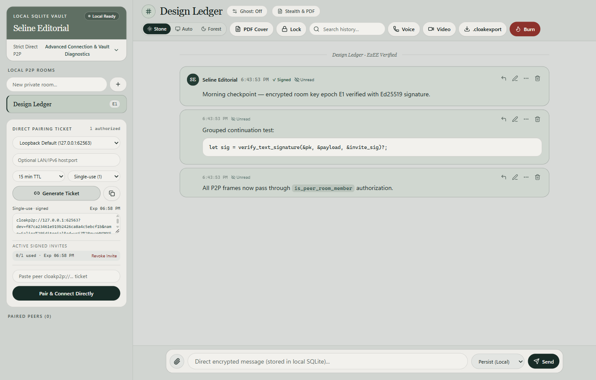
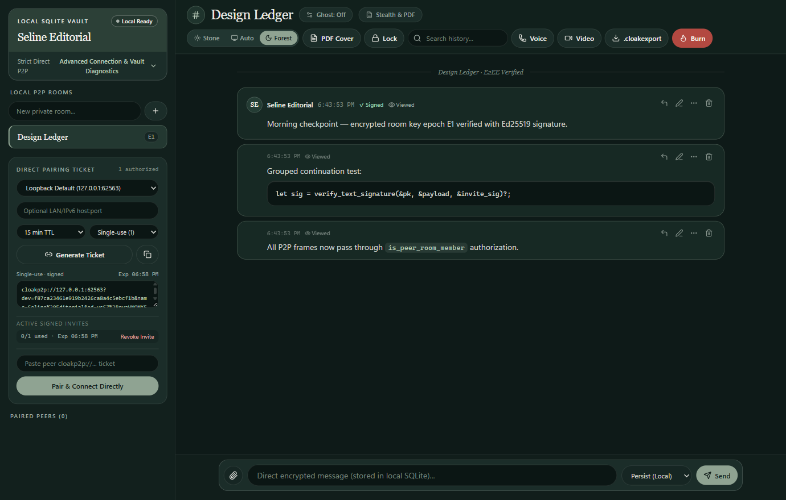
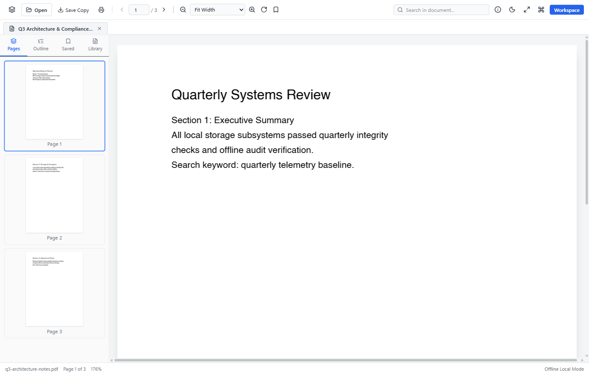
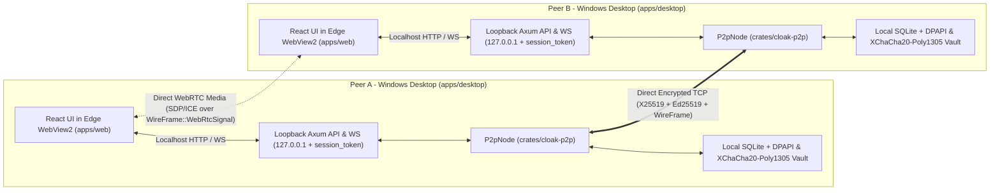
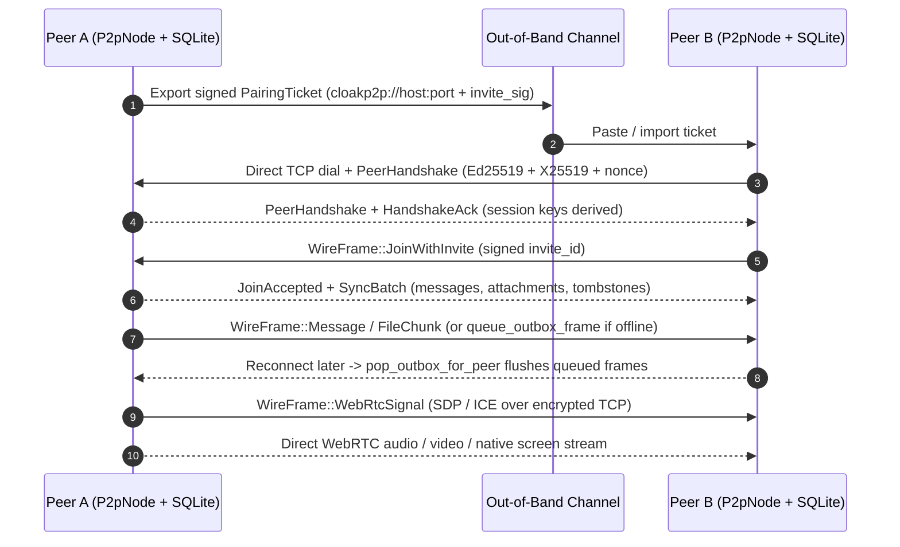

# Cloak

**A local-first, Rust-powered peer-to-peer desktop messenger engineered for privacy, verifiable encryption, and deniable discretion.**

Built with a native Rust P2P transport and SQLite vault engine (`cloak-p2p`), a native Windows Edge WebView2 desktop shell (`cloak-desktop`), and a retro-modern Stone & Sage React frontend (`@cloak/web`).

---

## Visual Overview

| Light Mode (Stone & Sage) | Dark Mode (Deep Forest) |
| :---: | :---: |
|  |  |

| Stealth PDF Decoy (`Document Reader`) |
| :---: |
|  |

---

## Architecture Overview

Every Cloak client runs a complete local messaging node (`P2pNode`), local encrypted SQLite vault, loopback API server, and native Edge WebView2 UI inside a single desktop process (`apps/desktop`). Peers talk **directly machine-to-machine** over TCP and WebRTC with **no central chat, storage, or signaling server** in the path.



- **Local UI & API boundary:** The embedded WebView2 UI communicates only with a per-launch loopback Axum server on `127.0.0.1` guarded by a 32-byte `session_token` and Stealth lock middleware (`apps/desktop/src/server.rs`).
- **Local source of truth:** Messages, room keys, peer trust records, offline outbox frames, and deletion tombstones live in each peer's own sealed SQLite database—never in a cloud database.
- **No central server dependency:** While legacy `services/*` workspaces exist in the repository history, the native desktop application in `apps/desktop` operates fully peer-to-peer without starting or connecting to them.

---

## How Communication Works Without a Server

1. **Self-Owned Identity & Direct Listener (`P2pNode::start`)**
   Each desktop node generates its own **Ed25519** signing identity and **X25519** keypair inside its local vault, then binds a direct TCP listener (`--p2p-bind`) and discovers candidate interface addresses (`advertisedAddr` for LAN, Tailscale/VPN, or IPv6).

2. **Out-of-Band Signed Pairing (`cloakp2p://...`)**
   To connect without a directory server, Peer A generates a `PairingTicket` URI containing Peer A's `device_id`, public keys, direct and alternate socket addresses, room metadata/key epoch, plus a bounded `invite_id`, `expires_at_ms`, `max_uses` (default `1`), and an **Ed25519** signature (`invite_sig_b64`). You share that ticket over any channel you choose.

3. **Direct Dial & Mutual Cryptographic Handshake (`DirectOnly` by Default)**
   Peer B verifies the ticket signature locally and dials Peer A's socket candidates directly over TCP. By default (`ConnectivityMode::DirectOnly`), Cloak **refuses silent relay fallbacks** and reports actionable routing errors if no direct path succeeds (an opt-in `Assisted` mode exists for STUN/ICE assistance). Both peers run `PeerHandshake` (exchanging Ed25519 identity proofs, ephemeral X25519 keys, and 32-byte nonces), verify key pinning/revocation, confirm mutual HMAC transcript `HandshakeAck` frames, and derive session keys via `TransportSessionCrypto` (with in-session `WireFrame::Rekey` ratcheting).

4. **Room Admission & State Sync**
   Transport authentication alone does not grant room access. Peer B presents `WireFrame::JoinWithInvite`; Peer A validates the signature, expiry, revocation status, and remaining uses atomically in `room_invitations` before replying with `JoinAccepted` or `JoinRejected`. Once admitted to `room_members`, peers synchronize history directly using `SyncRequest` and `SyncBatch`.

5. **Direct Fan-Out & Offline Outbox (`queue_outbox_frame` / `pop_outbox_for_peer`)**
   When sending a message or file, the sender persists it in SQLite and writes encrypted frames (`WireFrame::Message`, `FileInit`, `FileChunk`, `Tombstone`) directly to currently connected `room_members`. If a peer is offline, frames are queued locally per peer in SQLite and automatically flushed as soon as that peer reconnects and passes handshake authentication.

6. **Serverless Voice, Video & Screen Sharing**
   Instead of a central WebRTC signaling server, SDP offers/answers and ICE candidates travel directly inside the authenticated, encrypted P2P TCP tunnel as `WireFrame::WebRtcSignal`, establishing direct peer-to-peer media streams between the two clients.



---

## Core Capabilities

### 1. Zero-Server Direct P2P & Signed Room Authorization
- **Direct Peer Transport:** Peer-to-peer TCP transport using **X25519** ephemeral key exchange, **Ed25519** identity signatures, and **XChaCha20-Poly1305** message/chunk encryption (`crates/cloak-p2p`).
- **Strict Direct-Only Mode:** Refuses silent relay fallbacks by default when direct routing fails, reporting explicit connectivity diagnostics (with opt-in `Assisted` STUN configuration).
- **Room-Scoped Membership & Signed Invitations:**
  - `PairingTicket` URIs (`cloakp2p://...`) include an `invite_id`, issuance/expiry timestamps, `max_uses` (default `1` single-use), and an Ed25519 signature (`invite_sig_b64`).
  - `JoinWithInvite` -> `JoinAccepted` / `JoinRejected` admission gates every room; `room_members` and atomic `room_invitations` tracking prevent cross-room leaks, replay, expiry bypass, or unauthorized frame injection.
  - Revoking a peer (`revoke_peer`) marks room memberships revoked, purges queued outbox frames, and closes active TCP sessions immediately.

### 2. Local SQLite Vault & Encrypted Archives
- **Sealed Storage at Rest:** SQLite local persistence sealed with `XChaCha20-Poly1305` (`CLKBLOB1`) wrapped via Windows **DPAPI** (`CryptProtectData` / `CryptUnprotectData`).
- **Offline `.cloakexport` Archives:** Worker-based encrypted bundle export and verification (`packages/archive`) readable offline on `/archive`.

### 3. Ghost Mode Privacy System
- Configurable policies (`Privacy Shield`, `Clear Viewed`, `Clear Open Conversation`, per-room overrides, and Privacy PIN unlock).
- Tracks viewport dwell times, protects compose modals, prevents deleted/expired message resurrection via tombstones, and preserves peer call continuity cleanly.

### 4. Stealth Mode & Offline PDF.js Decoy
- **True Dual-Surface Concealment:** When locked, `server.rs` fail-closes all private messaging, peer, room, and capture HTTP/WS routes with `403 STEALTH_LOCKED`, displaying an offline **PDF.js Document Reader** (`PdfReaderShell`) complete with thumbnails, outline, bookmarks, search, and document properties.
- **Live Win32 Window & Tray Concealment:** `native_shell.rs` synchronizes both the Win32 `HWND` title and tray tooltip (`"Cloak"` <-> `"Document Reader"`) across lock and unlock transitions.
- **Secret Unlock & Native WinRT Hello:** Supports Argon2id-hashed search/command/shortcut secret codes, rate limiting, recovery codes, inactivity timers, and pure `combase.dll` WinRT `UserConsentVerifier` biometric/PIN probing (zero external PowerShell subprocesses).

### 5. WebRTC Media & High-Speed Win32 Screen Capture
- **Native Capture Pipeline (`apps/desktop/src/capture.rs` & `server.rs`):** Persistent `CreateDIBSection` top-down 32-bpp DIB capture session streaming raw RGBA frames over an authenticated loopback WebSocket (`/p2p/v1/capture/stream/{source_id}`) directly into `<canvas>` `putImageData` (with HTTP BMP fallback).
- **Measured Performance (`cloak-desktop.exe` `--release`, `1618x1072` window capture):**
  - `720p30` (`maxWidth=1280`, `fps=30`): **`33.10 ms/frame` (`30.21 fps`)**
  - `1080p30` (`maxWidth=1920`, `fps=30`): **`33.80 ms/frame` (`29.58 fps`)**
  - `1080p60` (`maxWidth=1920`, `fps=60`): **`19.48 ms/frame` (`51.34 fps` observed GDI ceiling; up from `9.33 fps` baseline)**

---

## Repository Structure

```text
.
├── apps/
│   ├── desktop/            # Native Windows WebView2 shell (tao/wry), Axum loopback API, Win32 capture, cloak-setup installer
│   └── web/                # React 19 + Vite 8 + Tailwind v4 frontend (/p2p workspace, PDF.js decoy, legacy server UI)
├── crates/
│   └── cloak-p2p/          # Core Rust library: Ed25519/X25519/DPAPI crypto, SQLite vault, P2P TCP transport, Ghost & Stealth engines
├── packages/               # Shared TypeScript packages (@cloak/protocol, @cloak/crypto, @cloak/archive, @cloak/config, @cloak/ui)
├── services/               # Legacy self-hostable backend crates (api, core, worker)
├── scripts/
│   ├── package-windows.ps1 # Builds Cloak-Setup-x64.exe & Cloak-Portable-win64.zip + SHA256SUMS.txt
│   └── two-pc-lan-qa.ps1   # Two-PC physical LAN/Firewall validation harness
├── tests/e2e/              # Playwright end-to-end suites (p2p-desktop.spec.ts, stealth-mode.spec.ts)
└── docs/                   # Phase 12 audit, security, media performance, visual QA, and release readiness reports
```

---

## Building & Running (Windows)

### Prerequisites
- **Rust** (`stable-x86_64-pc-windows-gnu` toolchain for Windows build & tests; Rust `>= 1.88`)
- **Node.js** (`>= 20`) & `npm`
- **Microsoft Edge WebView2 Runtime** (pre-installed on Windows 11)

### 1. Build Frontend Assets & Native Desktop Binary

Always build the frontend before compiling `cloak-desktop`, as `server.rs` embeds `apps/web/dist` at compile time via `include_dir!`:

```powershell
npm install
npm run build
cargo +stable-x86_64-pc-windows-gnu build --release -p cloak-desktop --bins
```

Launch Cloak Desktop directly:

```powershell
.\target\release\cloak-desktop.exe
```

### 2. Package Windows Installer & Portable Bundle

```powershell
powershell -ExecutionPolicy Bypass -File scripts/package-windows.ps1
```

Outputs to `dist-windows/`:
- `Cloak-Setup-x64.exe` (single-file self-extracting installer with Start Menu/Desktop shortcuts, Add/Remove Programs registry entry, and uninstaller)
- `Cloak-Portable-win64.zip` (self-contained portable folder with `--data-dir .\cloak-data`)
- `SHA256SUMS.txt`

---

## Verification & Test Suites

```powershell
# Rust formatting, strict Clippy, and all core + HTTP security tests
cargo fmt --check
cargo +stable-x86_64-pc-windows-gnu clippy -p cloak-p2p -p cloak-desktop --all-targets -- -D warnings
cargo +stable-x86_64-pc-windows-gnu test -p cloak-p2p -p cloak-desktop -- --test-threads=1

# TypeScript checks, ESLint, and Vitest unit suites
npm run typecheck
npm run lint
npm run test:unit

# Full Playwright E2E suite (P2P pairing, Ghost Mode, WebRTC + native capture, Stealth PDF decoy)
npx playwright test tests/e2e/p2p-desktop.spec.ts tests/e2e/stealth-mode.spec.ts
```

---

## Current Verification Scope & Honest Limitations

- **Verified on One Physical Windows Host:** All Rust unit/integration suites (`16/16` `cloak-p2p`, `2/2` `cloak-desktop`), TypeScript unit tests (`15/15`), Playwright E2E specs (`4/4`), native Edge WebView2 CDP layout/HWND inspections (`6` PNGs), silent installer parity/boot/uninstall checks, and live WebSocket RGBA capture benchmarks pass cleanly on a single Windows 11 host.
- **Pending Physical Two-PC Hardware:** Multi-machine LAN and cross-subnet WAN/NAT traversal (`scripts/two-pc-lan-qa.ps1`) have not yet been executed between two separate physical PCs.
- **Capture & Biometric Caveats:** Window capture (`win:*`) reaches `51.34 fps` under GDI `PrintWindow` + `CreateDIBSection` (60 fps sustained across `4K`/locked full-monitor surfaces would require DXGI Desktop Duplication in a future iteration); full-monitor `GetDC` capture (`mon:0`) fails cleanly when the Windows interactive session is locked; Windows Hello COM probing is unit-tested, while interactive hardware biometric prompt dialogs require manual desktop sign-in.

---

## Documentation Index

- [Phase 12 Audit](docs/PHASE_12_AUDIT.md)
- [Phase 12 Security Verification](docs/PHASE_12_SECURITY.md)
- [Phase 12 P2P Validation](docs/PHASE_12_P2P_VALIDATION.md)
- [Phase 12 Media & Screen-Share Performance](docs/PHASE_12_MEDIA_PERFORMANCE.md)
- [Phase 12 UI Redesign & Bundle Metrics](docs/PHASE_12_UI_REDESIGN.md)
- [Phase 12 Visual QA](docs/PHASE_12_VISUAL_QA.md)
- [Phase 12 Test Results](docs/PHASE_12_TEST_RESULTS.md)
- [Phase 12 Release Readiness](docs/PHASE_12_RELEASE_READINESS.md)

